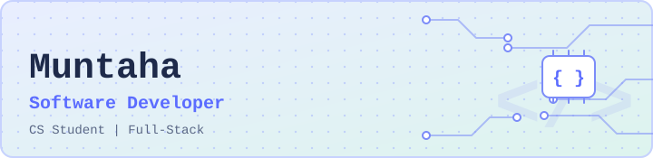

# Hi there 👋, it's me Muntaha

  

## 👩‍💻 About Me

CS student who loves turning ideas into working software, with a growing passion for full-stack development and always picking up something new along the way.

- 🔭 Currently building desktop apps with **Java Swing** and full-stack apps with **Rails and Next.js**
- 🌱 Learning more about **Spring Boot, Rails, React and Next.js**
- 💬 Ask me about **Java, OOP and web basics**
- ⚡ Fun fact: I once got stuck inside vim and escaped with `:q!`

## 🛠 Tech Stack

**Languages**

**Frameworks**

**Database and Tools**

**IDE**

## 📫 Contact

📧 sidratulmuntahanidhi011@gmail.com
